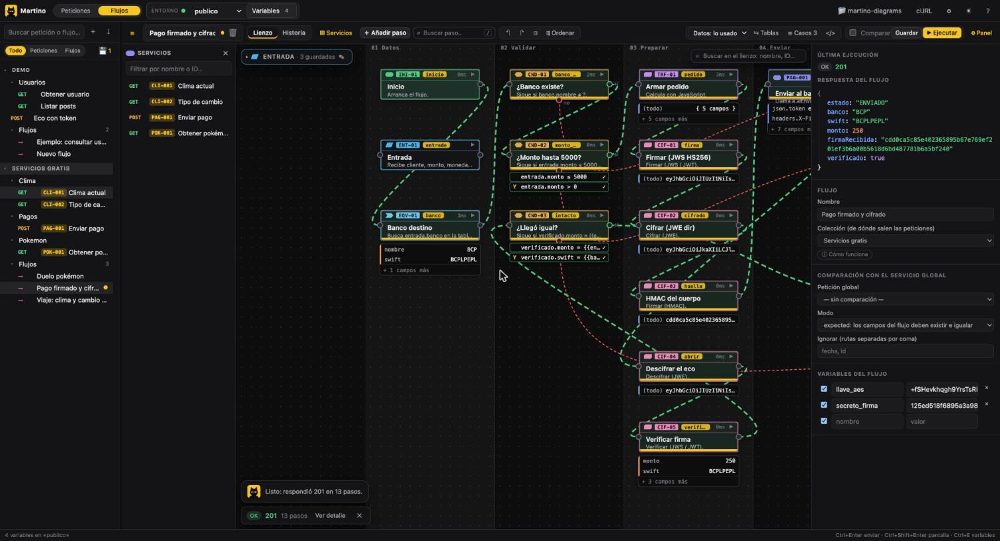
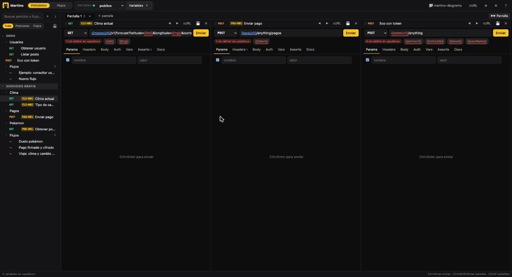
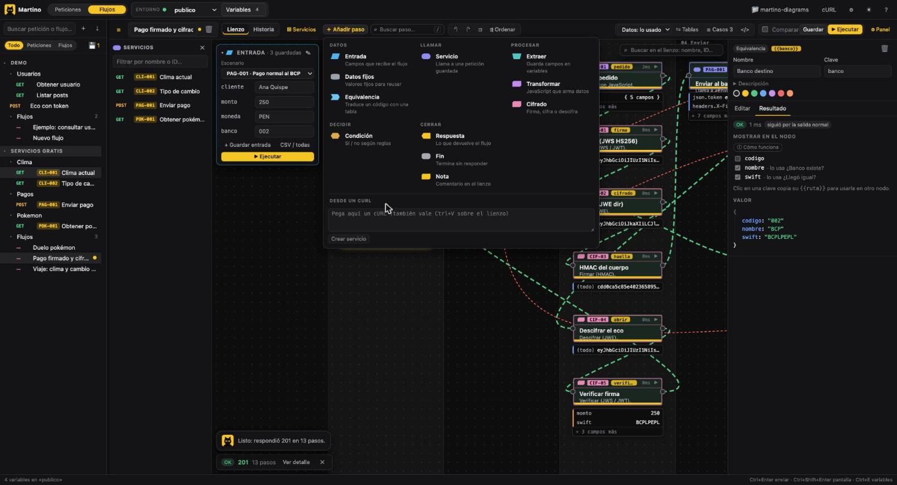
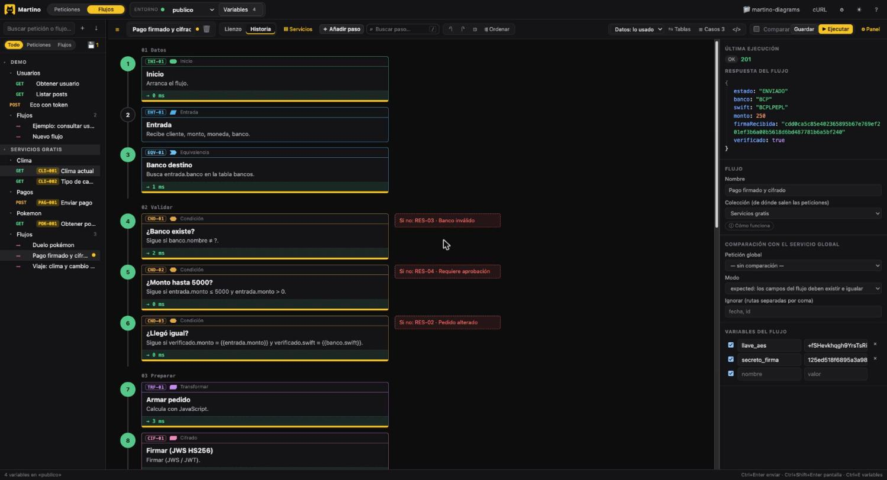
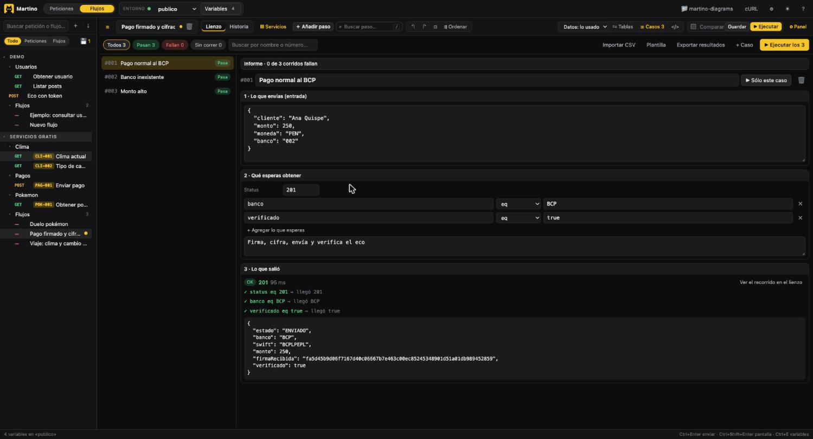
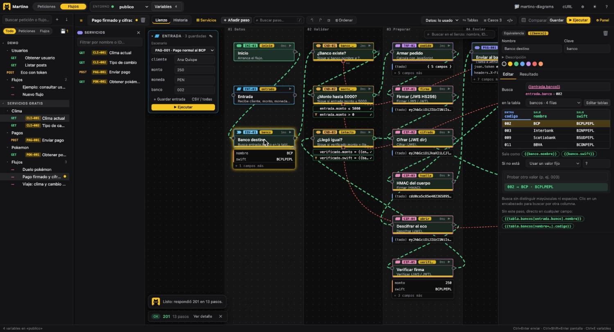
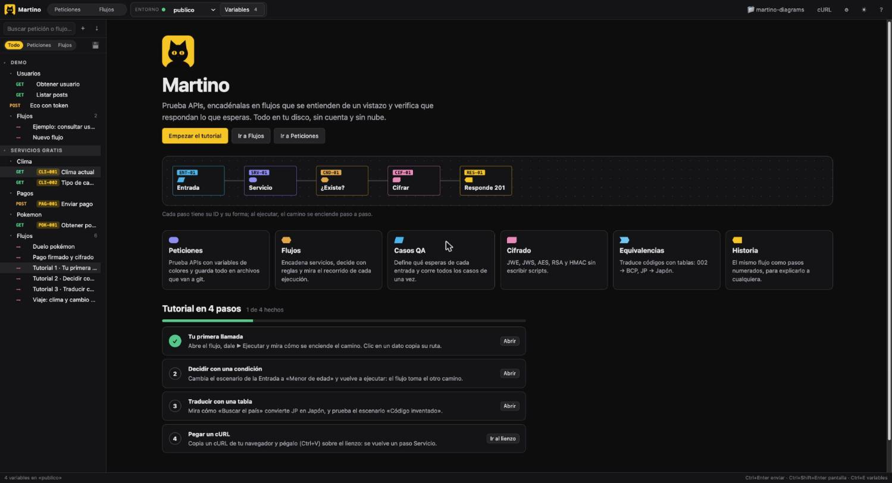

<p align="center">
  
</p>

<h1 align="center">Martino</h1>

<p align="center">
  <b>Cliente HTTP local, compatible con Bruno, con flujos visuales, casos QA y cifrado.</b><br>
  Un solo ejecutable, sin cuenta y sin nube: tus colecciones son archivos de texto (<code>.yml</code> o <code>.bru</code>) en tu disco y van a git.
</p>

<p align="center">
  <a href="https://github.com/YeyitoDev/martino-diagrams/releases/latest">Descargar</a> ·
  <a href="https://yeyitodev.github.io/martino-diagrams/">Sitio y planes</a> ·
  <a href="#funciones">Funciones</a> ·
  <a href="LICENSE">AGPL-3.0</a>
</p>



```
 ┌─ Colección (.bru) ─┐     ┌──────── Flujo visual ────────────────────────────────┐
 │ Usuarios/          │     │ Entrada ─► Obtener cuenta ─► ⇆ Equivalencia ─► 🔒 JWE │
 │   Obtener usuario  │ ──► │                 │ error            banco → BCP    │     │
 │   Listar posts     │     │                 ▼                                ▼     │
 │ environments/dev   │     │               Fin ✗                     Enviar al banco │
 └────────────────────┘     └──────────────────────────────────────────────────────┘
        petición sola                 peticiones encadenadas + casos QA
```

- [Descargar](#descargar) · [Primeros pasos](#primeros-pasos) · [Funciones](#funciones) · [Línea de comandos](#línea-de-comandos)
- [Acceso remoto y servidor](#acceso-remoto-y-servidor) · [Compilar](#compilar-desde-el-código) · [Arquitectura](#arquitectura)
- [Licencia](#licencia) · [Para empresas](#para-empresas)

---

## Por qué Martino

| | Postman | Bruno | **Martino** |
|---|---|---|---|
| Colecciones en archivos de texto (git) | ❌ nube | ✅ `.yml` / `.bru` | ✅ **los mismos archivos** |
| Funciona sin cuenta ni internet | ⚠️ | ✅ | ✅ |
| Encadenar peticiones en un diagrama | ⚠️ Flows (pago) | ❌ | ✅ |
| Casos QA desde un CSV | ⚠️ Runner | ⚠️ | ✅ con comparación de respuesta |
| JWE / JWS / AES / RSA sin escribir scripts | ❌ | ❌ | ✅ |
| Tablas de equivalencia (códigos ⇄ nombres) | ❌ | ❌ | ✅ |
| Un solo ejecutable (12 MB en Windows, 27 MB en Mac universal), la UI va adentro | ❌ | ❌ (Electron) | ✅ |

---

## Descargar

Cada versión publica los ejecutables en **[Releases](https://github.com/YeyitoDev/martino-diagrams/releases/latest)**:

| Sistema | Archivo | Nota |
|---|---|---|
| macOS (Apple Silicon e Intel) | `martino-mac` | Binario universal, 27 MB |
| Windows 10/11 | `martino-windows.exe` | 12 MB |

**Primera vez en Mac:** el ejecutable no está firmado por Apple. Dale permiso así:

```bash
chmod +x martino-mac
xattr -d com.apple.quarantine martino-mac   # o clic derecho → Abrir
./martino-mac
```

En Windows, si SmartScreen avisa: «Más información» → «Ejecutar de todas formas».

---

## Primeros pasos

1. **Abre el ejecutable con doble clic.** Martino levanta `http://127.0.0.1:4400` y abre tu navegador.
2. **Carpeta de trabajo:** si la carpeta actual ya tiene `collections/`, usa esa; si no, la última que abriste; si no, `~/Martino`.
3. **Trae tus peticiones:** abre una colección de Bruno, importa una de Postman v2.1 o pega un cURL.

Así queda la carpeta de trabajo:

```
mi-proyecto/
├── collections/
│   └── demo/                     ← una colección de Bruno, tal cual
│       ├── bruno.json
│       ├── collection.bru
│       ├── environments/dev.bru  ← variables por entorno (los secretos NO van aquí)
│       ├── Usuarios/Obtener-usuario.bru
│       └── tablas/bancos.csv     ← tablas de equivalencia
├── flows/*.flow.json             ← flujos visuales y sus casos QA
├── workbench.config.json         ← ajustes del equipo (opcional, va a git)
├── workbench.local.json          ← tus ajustes (no va a git)
└── .workbench/                   ← secretos, pestañas abiertas, temporales (no va a git)
```

> **Secretos:** las variables marcadas como secretas en un entorno se guardan en
> `.workbench/secrets.json`, nunca en el `.bru`. Así puedes subir la colección a git sin filtrar tokens.

---

## Funciones

### Peticiones



- **Compatible con Bruno:** las peticiones nuevas se guardan en **YAML** (el formato OpenCollection de Bruno, `.yml`) y las que ya tienes en `.bru` se siguen leyendo y guardando como `.bru`. Método, URL, headers, query, body JSON/texto/form, auth básica y bearer, variables y asserts.
- **Variables con colores:** cada `{{var}}` muestra de dónde sale. El orden de prioridad es:
  `runtime > vars:pre-request > entorno (secretos incluidos) > collection.bru > .env`.
- **cURL de ida y vuelta:** pega un cURL y se vuelve petición; cualquier petición se copia como cURL.
- **Postman:** importa colecciones y entornos v2.1, desde la UI o con `martino import-postman`.
- **TLS corporativo:** CA propia (`tls.caFile`) o desactivar la verificación, desde Ajustes.

### Temporales e ID doble

Lo que pegas de un cURL se abre como **temporal** (borde punteado, etiqueta `TMP`): puedes probarlo sin ensuciar la colección ni git. Si te sirve, **«Guardar en la colección»** le asigna un **ID**:

| Situación | ID que recibe |
|---|---|
| La petición no traía ID | El siguiente libre de la carpeta: `Usuarios` → `USU-001`, `USU-002`… |
| Traía un ID libre (`PAG-014`) | **Se respeta** |
| Traía un ID ya usado | Te propone el siguiente libre y te lo dice |

El ID se guarda en el archivo de la petición (`info.id` en `.yml`, `meta { id }` en `.bru`) y aparece en el árbol, en la pestaña y en el paso del flujo que la usa.

### Flujos visuales

Encadena peticiones como pasos de un diagrama. Cada paso puede usar lo que devolvieron los anteriores: `{{cuenta.response.id}}`.

- **Cada paso es una ficha** con su **ID fijo** (`SRV-01`, `CND-02`, `EQV-01`; un Servicio muestra el ID de su petición, `PAG-001`), la **forma de su tipo** y **una frase** que dice qué hace: «Busca entrada.banco en la tabla bancos», «Sigue si entrada.monto ≤ 5000».
- **Carriles por etapa:** **⇶ Ordenar** acomoda cada paso en su fase, *Datos → Validar → Preparar → Enviar → Responder*, y lo deshaces con Ctrl+Z.
- **Ejecutar se ve:** el camino recorrido se pinta en verde, lo que no corrió se apaga y **el gato narra** cada paso («Paso 8 · PAG-001 Enviar al banco: 200 · 184 ms»).
- **Añadir pasos:** botón **«＋ Añadir paso»** (menú por grupos, con nombre y para qué sirve) o **`/`** para buscarlo por lo que quieres hacer: «cifrar», «si», «llamar».
- **Columna de Servicios:** las peticiones de la colección, filtrables por nombre o ID; clic o arrastrar crea el paso.
- **Pegar un cURL** sobre el lienzo (Ctrl+V) o en «＋ Añadir paso» crea un Servicio con esa petición.
- **Entrada siempre a la vista**, con **escenarios** (código y nombre) que cambian los valores de un clic; se oculta con ▾.
- **Condiciones legibles:** «Si `entrada.monto` *Menor o igual que (LTE)* `5000` Y si…», con varias reglas Y/O; tras ejecutar, cada regla dice su valor y si se cumple.
- **Mapeo sin errores:** clic en un campo de la respuesta copia su `{{ruta}}`; al pegarla en otro paso se ve su valor debajo; escribir `entrada.` autocompleta los campos.
- **Buscador del lienzo**, **nodos redimensionables** y **respuesta recortada** bajo cada paso (sólo los campos que usa alguien).
- **YAML legible:** cada flujo se puede ver y editar como YAML en español.

| Paso | Qué hace |
|---|---|
| **Entrada** `ENT` | Datos con los que arranca el flujo (el «input» de cada caso QA) |
| **Servicio** `SRV` | Ejecuta una petición; salida `siguiente` y `error` |
| **Extraer** `EXT` | Guarda valores de una respuesta en variables |
| **Condición** `CND` | Bifurca en `sí` / `no` con una o varias reglas (Y / O) |
| **Datos fijos** `DAT` | Un JSON constante |
| **Transformar** `TRF` | JavaScript que arma datos nuevos con `nodes`, `input` y `env` |
| 🔒 **Cifrado** `CIF` | Cifra, descifra, firma o verifica (ver abajo) |
| ⇆ **Equivalencia** `EQV` | Busca un valor en una tabla (ver abajo) |
| **Respuesta** `RES` | Lo que devuelve el flujo (se compara en los casos QA) |
| **Fin** `FIN` · **Nota** `NOT` | Termina la rama · documentación en el diagrama |



**Vista Historia:** el mismo flujo como pasos numerados por etapa, con las salidas de error al costado. Sirve para explicarlo a quien no programa (botón **Lienzo | Historia**).



### Casos QA

Cada flujo tiene una tabla de casos: **entrada → resultado esperado**. Los mismos casos son los escenarios de la Entrada.



- Se cargan desde un **CSV** (Martino te da la plantilla con las columnas correctas).
- Comparación **por campos** o contra la respuesta esperada completa, con campos a ignorar (fechas, ids).
- Se ejecutan todos de una vez, en la UI o en CI con `martino flow <id> --cases` (sale con código 1 si alguno falla).

### Cifrado

Sin scripts: eliges formato, operación y llave. Todo corre en Rust (librerías RustCrypto), no en el navegador.

| Formato | Operaciones | Algoritmos |
|---|---|---|
| **JWE** (compacto, RFC 7516) | cifrar / descifrar | `RSA-OAEP-256`, `RSA-OAEP`, `A256KW`, `dir` × `A256GCM`, `A128CBC-HS256` |
| **JWS / JWT** | firmar / verificar | `RS256`, `PS256`, `HS256` |
| **AES-256-GCM** | cifrar / descifrar | salida `base64(iv ‖ ct ‖ tag)` o hex |
| **AES-256-CBC** | cifrar / descifrar | salida `base64(iv ‖ ct)`, PKCS#7 |
| **RSA-OAEP** | cifrar / descifrar | SHA-256 o SHA-1 |
| **HMAC** | firmar / verificar | SHA-256, SHA-512 (firmas de webhooks) |
| **SHA** | huella | SHA-256, SHA-512 |
| **Base64** | codificar / decodificar | estándar o url-safe |

- **Llaves:** PEM (pública o privada) o, para AES, 32 bytes en base64, hex o texto. Lo normal es que sean un **secreto del entorno**: `{{publica_banco}}`.
- **«Generar llave de prueba»** crea un par RSA 2048 o una llave AES y la deja en las variables del flujo, para probar sin pedirle nada a nadie.
  ⚠️ Esas variables se guardan en el `.flow.json`: **no uses llaves reales ahí**.
- El resultado de un JWE/JWS se muestra **por partes y con colores** (cabecera, llave, IV, contenido, tag).
- Probado contra `crypto` de Node.js en ambos sentidos (JWE, JWS RS256 y AES-GCM).

### Tablas de equivalencia

Para traducir códigos: `002 → BCP`, `PE → Perú`, `ACTIVO → A`.

- Son CSV en `collections/<col>/tablas/`; la primera fila son los nombres de las columnas.
- Se editan como hoja de cálculo dentro de Martino (cada celda se guarda sola) o se importan desde un CSV.
- El paso ⇆ **Equivalencia** muestra la tabla con la columna que **ENTRA** y las que **SALEN**, resalta la fila encontrada y deja **probar** otro valor. Clic en un encabezado busca por esa columna (al revés). No distingue mayúsculas ni espacios y devuelve la fila completa: `{{banco.nombre}}`, `{{banco.swift}}`.
- **Si no está:** detener el flujo con un error claro, dejar el valor igual o usar un valor por defecto.
- **Sin paso, en cualquier campo** (URL, header, body, condición):

  ```
  {{tabla.bancos[entrada.banco].nombre}}            → BCP
  {{tabla.bancos[nombre=BBVA].codigo}}              → 011   (al revés)
  {{tabla.bancos.buscar("nombre", "BBVA").swift}}   → BCONPEPL
  ```



---

## Flujos de ejemplo (servicios gratis, sin llaves)

**Al abrir Martino por primera vez** aparece el **Inicio**: qué hace cada parte, una animación de un flujo ejecutándose y un **tutorial de 4 pasos** que abre los flujos «Tutorial 1–3». Vuelves a él con el gato de arriba a la izquierda.



La colección `collections/gratis` trae 6 flujos listos para ejecutar con el entorno **publico**, de más fácil a más complejo. Cada uno tiene sus casos QA:

| Flujo | Qué muestra | Servicios | Casos |
|---|---|---|---|
| **Tutorial 1 · Tu primera llamada** | Entrada → un servicio → respuesta; copiar rutas de la respuesta | Open-Meteo | 1 (Lima) |
| **Tutorial 2 · Decidir con una condición** | Una regla `edad ≥ 18` y dos caminos; escenarios en la Entrada | ninguno (sin internet) | 2 |
| **Tutorial 3 · Traducir con una tabla** | Paso Equivalencia (JP → Japón) y la sintaxis `{{tabla.paises[codigo=…].moneda}}` | ninguno | 2 (Japón, código inventado) |
| **Viaje: clima y cambio por país** | Tabla `paises` → 2 servicios **en paralelo** → unión en JavaScript → condición | Open-Meteo, ExchangeRate-API | 3 (Perú, Japón, país que no existe) |
| **Pago firmado y cifrado** | Tabla `bancos` → reglas → **JWS** → **JWE** → **HMAC** en header → envío → descifra y verifica el eco | httpbin | 3 (pago OK, banco inválido, monto alto) |
| **Duelo pokémon** | 2 servicios en paralelo → unión → tabla `tipos` (inglés → español) → empate o ganador | PokéAPI | 4 (incluye 404 de un nombre inventado) |

```bash
martino flow gratis--tutorial-1 --env publico --cases
martino flow gratis--viaje --env publico --cases
martino flow gratis--pago-cifrado --env publico --cases
martino flow gratis--duelo-pokemon --env publico --cases
```

> Las llaves del flujo de pago son **de prueba** y están en sus Variables. No las uses para nada real.

---

## Línea de comandos

```bash
martino                                   # = serve --open (doble clic)
martino serve [--port 4400] [--open] [--public]
martino --root ./mi-proyecto serve        # carpeta de trabajo explícita

martino flow <id> [--env dev] [--input entrada.json] [--compare]
martino flow <id> --cases                 # todos los casos QA; exit 1 si falla alguno

martino import-postman coleccion.json [--name Nombre]
martino import-postman entorno.json --collection demo
```

Ejemplo en CI (GitHub Actions):

```yaml
- run: ./martino --root . flow ejemplo--consultar-usuario --env qa --cases
```

---

## Acceso remoto y servidor

Martino **sólo escucha en `127.0.0.1`** y rechaza cualquier `Host` u `Origin` que no sea local (protección contra DNS rebinding). Cada llamada a `/api` exige además el header `X-Workbench: 1`.

Para usarlo desde otro equipo existe el **modo público**: acepta peticiones que llegan por un túnel conocido (`*.ts.net` de Tailscale o `*.trycloudflare.com`), siempre con una **llave**.

```
 tu laptop (remoto) ──HTTPS──► Tailscale (sólo tu red) ──► 127.0.0.1:4400 Martino --public
                                   ?key=… la primera vez, luego cookie HttpOnly por 12 h
```

> ⚠️ **No lo expongas a internet sin llave:** Martino puede leer y escribir archivos de su carpeta y hacer
> peticiones a cualquier URL. Para un servidor en la nube usa el modo de [Fly](#en-fly-internet-con-llave), que exige la llave siempre.

### En una Mac (servicio permanente + Tailscale)

En la Mac que hará de servidor, con Tailscale ya conectado:

```bash
curl -fsSL https://raw.githubusercontent.com/YeyitoDev/martino-diagrams/master/scripts/instalar-mac.sh | bash
```

El script ([`scripts/instalar-mac.sh`](scripts/instalar-mac.sh)):

1. Descarga la última versión a `~/Martino/bin/martino`.
2. Genera una llave fija en `~/Martino/.llave` (sólo la primera vez).
3. Lo registra como **LaunchAgent** (`~/Library/LaunchAgents/dev.martino.plist`): arranca solo y se reinicia si se cae.
4. Ejecuta `tailscale serve --https=4400` (**sólo tu tailnet**, sin Funnel).
5. Te imprime el enlace: `https://<tu-mac>.<tailnet>.ts.net:4400/?key=…`.

Volver a correrlo **actualiza** a la última versión y conserva la llave y los datos. Para desinstalar:

```bash
launchctl bootout gui/$(id -u)/dev.martino && rm ~/Library/LaunchAgents/dev.martino.plist
tailscale serve --https=4400 off
```

### En Fly (internet, con llave)

Martino también corre en [Fly.io](https://fly.io) como `https://martino.fly.dev`, **siempre con llave**:

- `MARTINO_BIND=0.0.0.0` sólo funciona en modo público, y **entonces la llave se pide a todo el mundo**, también a quien diga ser `127.0.0.1`.
- `MARTINO_PUBLIC_HOST` acepta sólo tu dominio exacto.
- Los datos viven en un volumen (`/data`); la primera vez se llena con las colecciones y flujos de ejemplo.

Una sola vez, desde una terminal con sesión en Fly (`fly auth login`) y en GitHub (`gh auth login`):

```bash
curl -fsSL https://raw.githubusercontent.com/YeyitoDev/martino-diagrams/master/scripts/fly-setup.sh | bash
```

[`scripts/fly-setup.sh`](scripts/fly-setup.sh) crea la app y el volumen, genera la llave, guarda el token de despliegue como secreto `FLY_API_TOKEN` del repo y te muestra tu enlace `https://martino.fly.dev/?key=…`. Desde ahí, **cada push a `master` se despliega solo**: el workflow [`deploy.yml`](.github/workflows/deploy.yml) compila, corre las pruebas y despliega. Archivos: [`fly.toml`](fly.toml), [`deploy/`](deploy).

### A mano (cualquier sistema)

```bash
export MARTINO_PUBLIC_KEY=$(openssl rand -hex 16)   # mínimo 24 caracteres; si falta, se genera una al azar
martino --root ~/Martino serve --public
tailscale serve --bg --https=4400 http://127.0.0.1:4400
```

---

## Compilar desde el código

Necesitas Rust estable, el target `wasm32-unknown-unknown` y [trunk](https://trunkrs.dev).

```bash
rustup target add wasm32-unknown-unknown
cargo install trunk

(cd crates/web && trunk build --release)   # UI → crates/web/dist (se embebe en el binario)
cargo build --release -p martino           # → target/release/martino
cargo test                                 # núcleo + servidor
```


**Publicar una versión:** `git tag v0.2.0 && git push --tags`. El workflow [`release.yml`](.github/workflows/release.yml) compila Mac (universal) y Windows, y sube los ejecutables al Release.

---

## Arquitectura

```
crates/
├── core/    martino-core: modelo y lógica pura, compila a nativo y a WASM
│            .yml/.bru ⇄ modelo · cURL · Postman · flujos y su YAML · casos QA · CSV
│            plantillas {{…}} (también {{tabla.…}}) · qué campos usa cada paso · tablas
│            IDs de pasos y carriles por etapa · specs de cifrado
├── server/  martino: axum + CLI. Ejecuta peticiones (reqwest), corre flujos,
│            guarda en disco, cifra (RustCrypto) y embebe la UI ya compilada
└── web/     martino-web: UI en Leptos 0.8 (CSR → WASM), instalable como PWA
```

- **Una sola lógica:** los formatos de petición, las plantillas y las reglas de los flujos viven en `core`; la UI y el servidor usan el mismo código.
- **Disco como base de datos:** no hay base de datos. Colecciones = carpetas de Bruno, flujos = JSON, estado = `.workbench/`.
- **Borrar no destruye:** una colección borrada va a `.workbench/papelera/`, con sus secretos.

---

## Licencia

Martino se publica bajo la **[GNU AGPL-3.0](LICENSE)**.

**Qué significa para ti:**

| Si tú… | ¿Puedes? | Condición |
|---|---|---|
| Lo usas en tu trabajo, en tu empresa, para clientes | ✅ | Ninguna |
| Lo modificas para uso interno | ✅ | Ninguna mientras no lo ofrezcas a terceros |
| Lo redistribuyes (con o sin cambios) | ✅ | Con el código fuente y bajo AGPL |
| **Lo ofreces como servicio por red** (SaaS, portal interno para clientes) | ✅ | **Debes publicar tu código modificado** bajo AGPL |
| Lo metes dentro de un producto cerrado | ❌ | Necesitas una **licencia comercial** ([abajo](#para-empresas)) |

### Por qué AGPL y no otra

| Licencia | Tipo | Quien lo usa debe… | Una empresa puede venderlo cerrado | Protege contra «nube que lo copia» |
|---|---|---|---|---|
| **MIT** | Permisiva | Mantener el aviso de copyright | ✅ Sí | ❌ |
| **Apache-2.0** | Permisiva | Aviso + registrar cambios; da licencia de patentes | ✅ Sí | ❌ |
| **GPL-3.0** | Copyleft | Publicar el código **si distribuye** el binario | ❌ | ❌ (usarlo como servicio no cuenta como distribuir) |
| **AGPL-3.0** ← | Copyleft de red | Publicar el código **si distribuye o lo ofrece por red** | ❌ | ✅ |
| **BSL / FSL** | Código visible | No competir comercialmente por 2–4 años; después pasa a ser abierta | ❌ | ✅, pero no es open source según la OSI |

- **Permisivas (MIT, Apache):** máxima adopción, pero cualquiera, incluida una empresa grande, puede tomar el código, cerrarlo y venderlo sin devolver nada.
- **GPL:** obliga a compartir a quien distribuye el programa, pero tiene un hueco: ofrecerlo como servicio web no es «distribuir».
- **AGPL:** cierra ese hueco. Para quien lo usa tal cual no cambia nada; sólo obliga a quien lo ofrece a otros como servicio.
- **BSL/FSL:** protegen más, pero no son open source formal y alejan contribuciones.

**Licencia dual:** como autor, puedo ofrecer además una **licencia comercial** a quien no pueda cumplir la AGPL (productos cerrados, políticas internas). Es el modelo de MySQL, Qt, MongoDB (antes) y Grafana.

---

## Para empresas

Martino es y seguirá siendo **gratis** para uso individual y en equipos. Para empresas hay servicios con soporte y factura:

| Plan | Para quién | Incluye |
|---|---|---|
| **Comunidad** · gratis | Personas y equipos | Todo Martino, AGPL, soporte en GitHub Issues |
| **Integración** · por proyecto | Equipos que integran con bancos, fintech o APIs con cifrado | Armamos tus flujos (JWE, firmas, tablas de códigos), tu suite de casos QA y su ejecución en CI |
| **Soporte Empresa** · mensual | Empresas que dependen de Martino | Respuesta en 1 día hábil, instalación en tus servidores, actualizaciones guiadas, licencia comercial incluida |
| **Licencia comercial** · anual | Quien lo integra en un producto cerrado | Uso sin las obligaciones de la AGPL |

Escríbenos abriendo un issue con la etiqueta **`empresa`**: <https://github.com/YeyitoDev/martino-diagrams/issues/new?labels=empresa>.

---

## Contribuir

1. Abre un issue antes de un cambio grande.
2. `cargo test` debe pasar y la UI debe compilar (`trunk build`).
3. Al enviar un PR aceptas que tu aporte se publique bajo AGPL-3.0 **y** que pueda incluirse en la licencia comercial (así el proyecto puede mantener la licencia dual).
